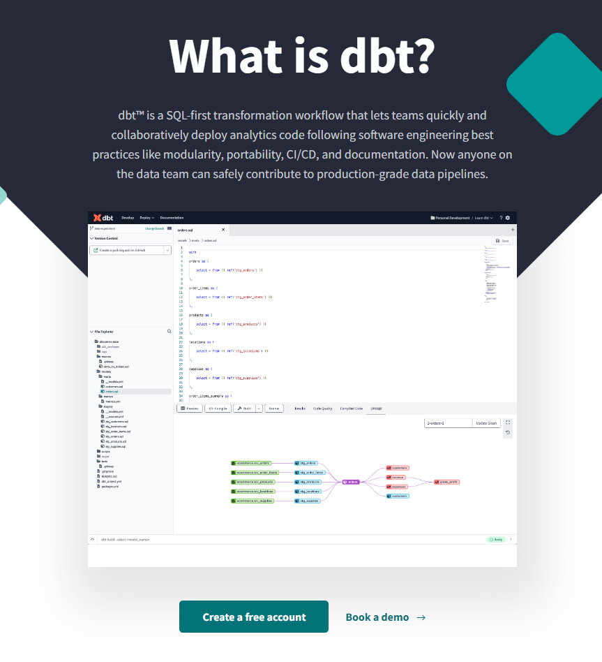
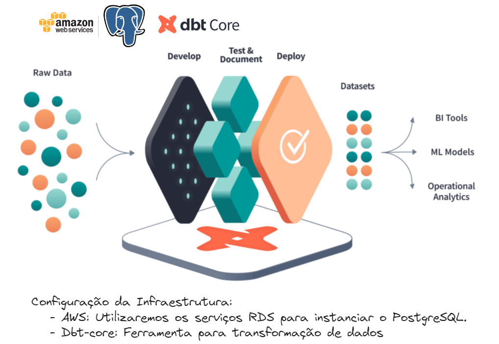
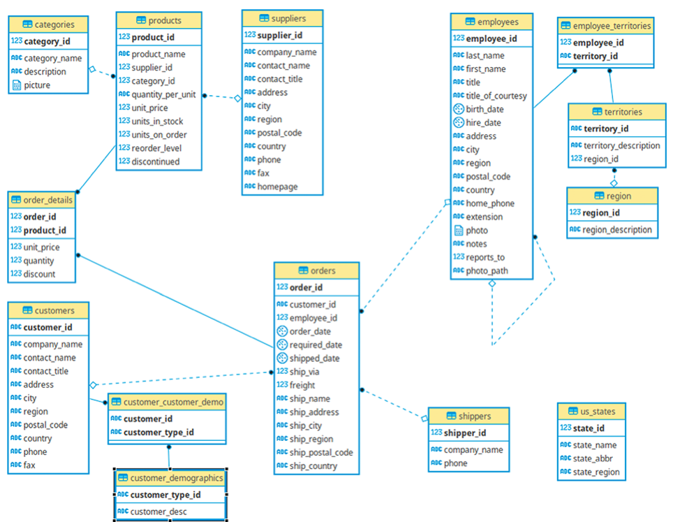
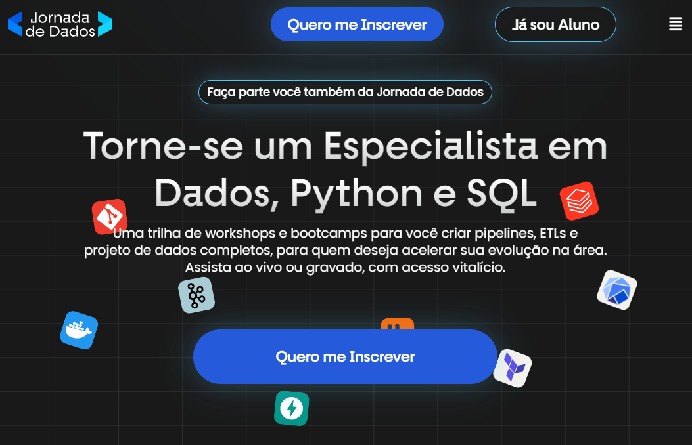
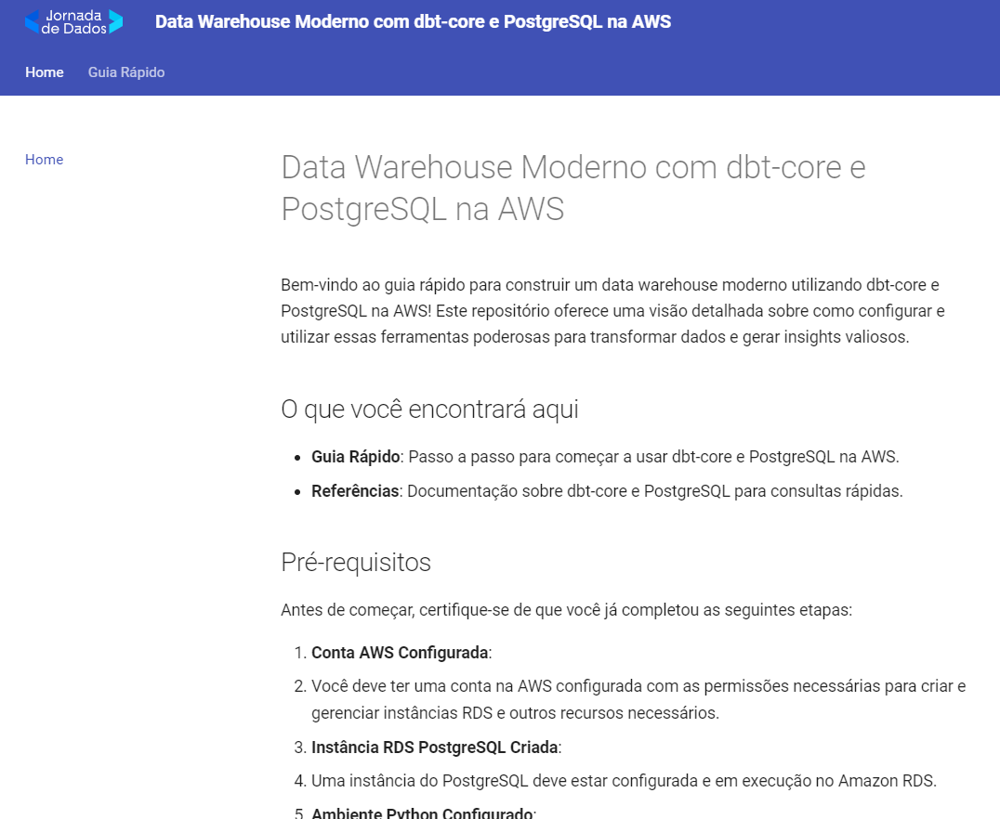

# dbt-core-northwind-project

Projeto de conclusão do bootcamp de SQL e analytics engineer da [Jornada de Dados](www.suajornadadedados.com.br)

## O que é dbt?

O dbt é um workflow de transformação focado em SQL que permite que equipes implementem código analítico de forma rápida e colaborativa, seguindo as melhores práticas de engenharia de software, como modularidade, portabilidade, CI/CD e documentação. Agora, qualquer pessoa da equipe de dados pode contribuir com segurança para pipelines de dados de nível de produção.

[](https://www.getdbt.com/product/what-is-dbt)

## Arquitetura moderna

Esse projeto tem como objetivo apresentar de forma prática uma solução completa de dados aproveitando os principais módulos e funcionalidades do dbt-core.



## Tabela de Conteúdos

- [dbt-core-northwind-project](#dbt-core-northwind-project)
  - [O que é dbt?](#o-que-é-dbt)
  - [Arquitetura moderna](#arquitetura-moderna)
  - [Tabela de Conteúdos](#tabela-de-conteúdos)
  - [Introdução](#introdução)
  - [Objetivo do Projeto](#objetivo-do-projeto)
  - [Pré-requisitos](#pré-requisitos)
  - [Hello World](#hello-world)
    - [1. Clonar o Repositório](#1-clonar-o-repositório)
    - [2. Executar os Contêineres Docker](#2-executar-os-contêineres-docker)
    - [3. Acessar o pgAdmin para visualizar o seu banco](#3-acessar-o-pgadmin-para-visualizar-o-seu-banco)
    - [3. Configurando o dbt\_profile.yml](#3-configurando-o-dbt_profileyml)
    - [5. Rode agora o primeiro comando dbt e veja tudo isso em segundos](#5-rode-agora-o-primeiro-comando-dbt-e-veja-tudo-isso-em-segundos)
    - [6. Gerar e Acessar a Documentação dbt](#6-gerar-e-acessar-a-documentação-dbt)
  - [Jornada de Dados](#jornada-de-dados)
  - [Veja a documentação completa\*\*:](#veja-a-documentação-completa)

## Introdução

A ferramenta dbt (data build tool) é uma solução inovadora no campo da engenharia de dados, projetada para conectar-se a repositórios de dados centralizados como Data Warehouses e Data Lakes. Ela habilita usuários de negócios, analistas e engenheiros a gerar transformações de dados, regras de negócios e insights valiosos de forma autônoma e eficiente.

## Objetivo do Projeto

O objetivo deste projeto é implementar uma solução de dados que foi inicialmente desenvolvida utilizando um processo padrão no PostgreSQL (criação de tabelas, views, procedures, etc.), mas agora utilizando dbt-core. A proposta é comparar as duas abordagens para evidenciar as vantagens e simplificações que o dbt-core pode oferecer em termos de manutenção, colaboração e escalabilidade das transformações de dados.

## Pré-requisitos

Antes de começar, certifique-se de ter os seguintes softwares instalados em seu sistema:

- [Git](https://git-scm.com/downloads): Para clonar o repositório.
- [Docker](https://www.docker.com/products/docker-desktop): Para executar os contêineres do PostgreSQL, pgAdmin e dbt.
- [Python](https://www.python.org/downloads/): Para rodar scripts auxiliares.

## Hello World

### 1. Clonar o Repositório

Primeiro, clone este repositório para o seu ambiente local usando Git. Abra um terminal e execute o seguinte comando:

```sh
git clone git@github.com:lvgalvao/dbt-core-northwind-project.git
cd dbt-core-northwind-project
```

### 2. Executar os Contêineres Docker

O `profiles.yml` deste projeto lê a conexão via `env_var()`, então o arquivo `.env` é
**obrigatório** para o ambiente subir. Ele está no `.gitignore` (por conter credenciais),
portanto não vem no clone — você precisa criá-lo a partir do exemplo:

```sh
cp .env.example .env
```

> Sem esse passo o `docker compose up` falha, porque as variáveis `DB_*` ficam vazias.

Com o `.env` no lugar, inicie os contêineres:

```sh
docker compose up -d --build
```

Isso iniciará os três contêineres: PostgreSQL, pgAdmin e dbt-core. O `healthcheck` do
Postgres garante que o pgAdmin e o dbt só iniciem depois que o banco estiver aceitando
conexões.

A base Northwind é carregada automaticamente **na primeira subida**, quando o volume
`postgres_data` ainda está vazio. Nas próximas vezes os dados já estão persistidos —
basta `docker compose up -d`. Para recomeçar do zero, use `docker compose down -v`
(o `-v` apaga os volumes) e suba novamente.

As portas expostas na máquina são configuráveis no `.env`:

| Serviço | Endpoint padrão |
| --- | --- |
| PostgreSQL | `localhost:5433` |
| pgAdmin | http://localhost:8081 |
| dbt docs | http://localhost:8082 |

### 3. Acessar o pgAdmin para visualizar o seu banco

Para acessar o pgAdmin e visualizar os dados, abra seu navegador e vá para:

- URL: http://localhost:8081

Ele está em modo desktop, ou seja, abre direto sem tela de login. Ao registrar o servidor,
use as seguintes credenciais:

- **Host**: `postgres` (o nome do serviço no compose, **não** `localhost` — o pgAdmin está
  na mesma rede Docker que o banco)
- **Porta**: `5432` (a porta interna do container, não a exposta na máquina)
- **Nome do Banco**: `northwind`
- **Usuário**: `northwind`
- **Senha**: `northwind`

Vamos trabalhar nesse projeto com a base northwind

O dbt é uma ferramenta focada na transformação de dados dentro de um pipeline de ETL/ELT, onde ETL significa Extrair, Transformar e Carregar. Ele se concentra especificamente no aspecto de Transformação (T), permitindo a criação de fluxos de trabalho de transformação de dados usando SQL.



Gaste uns 10 minutos avaliando o seu banco de dados sobre esses pontos

- Quais são minhas tabelas mais importantes?
- Que tipo de KPIs uma empresa dessa precisa?
- Qual a melhor forma de servir esses dados? que tabelas? modelagens?
- Como estruturar um Data Warehouse para garantir:
    1) que a transformação seja compatível com python e sql
    2) tenha versionamento de versão e CI/CD
    3) tenha testes unitários, testes de dados e documentação.

### 3. Configurando o dbt_profile.yml

```bash
northwind:
  outputs:
    dev:
      dbname: northwind
      host: localhost
      pass: postgres
      port: 5432
      schema: public
      threads: 1
      type: postgres
      user: postgres
  target: dev
```

Verifique sua configuração com o comando 

```bash
dbt debug
```

### 5. Rode agora o primeiro comando dbt e veja tudo isso em segundos

Deve ser muito complexo tudo isso, correto?

Mais ou menos

Você está pronto para rodar seu primeiro comando dbt? 

Abra um novo terminal e execute:

```sh
dbt run
```

Esse comando executará todas as transformações definidas nos modelos dbt e você verá a saída dos resultados no terminal.

### 6. Gerar e Acessar a Documentação dbt

A UI da documentação **não sobe junto com o `docker compose up`** — a porta 8082 é publicada,
mas nada escuta nela até você iniciar o servidor. São dois comandos:

```sh
docker compose exec dbt dbt docs generate
docker compose exec -d dbt python -m http.server 8080 --bind 0.0.0.0 --directory target
```

Abra seu navegador e vá para:

- URL: http://localhost:8082

Você verá a documentação interativa gerada pelo dbt, com o catálogo dos models, a linhagem
(DAG) e as descrições declaradas nos arquivos `.yml`.

> **Por que não `dbt docs serve`?** No dbt 1.8 esse comando escuta apenas em `127.0.0.1` e
> não oferece a flag `--host`. Dentro de um container isso o torna inalcançável de fora, e o
> mapeamento de porta não resolve. Servir o diretório `target/` com o `http.server` faz
> exatamente o mesmo que o `dbt docs serve` — ele apenas serve arquivos estáticos.

O servidor não sobrevive a um `docker compose restart` ou `down`, então rode o segundo comando
novamente quando precisar. Rode também o `dbt docs generate` sempre que alterar os models,
para o catálogo refletir o estado atual.

Se preferir rodar fora do Docker, com um ambiente virtual local:

```bash
python -m venv .venv
source .venv/Scripts/activate
pip install -r requirements.txt
```

```sh
dbt docs generate
dbt docs serve --port 8080
```

## Jornada de Dados

Esse projeto faz parte da comunidade de estudo Jornada de dados
Nossa missão é **fornecer o melhor ensino em engenharia de dados**



Se você quer:

1) Construir uma **base sólida** em Python e SQL
2) Aprender as **principais habilidades e ferramentas** de engenharia de dados
3) Criar ou melhorar seu **portfólio** de dados
4) Criar ou aumentar o seu **networking** na área
5) Mudar ou dar o **próximo passo em sua carreira**

A **Jornada de Dados** é o seu lugar

## Veja a documentação completa**:

[](https://lvgalvao.github.io/dbt-core-northwind-project/)